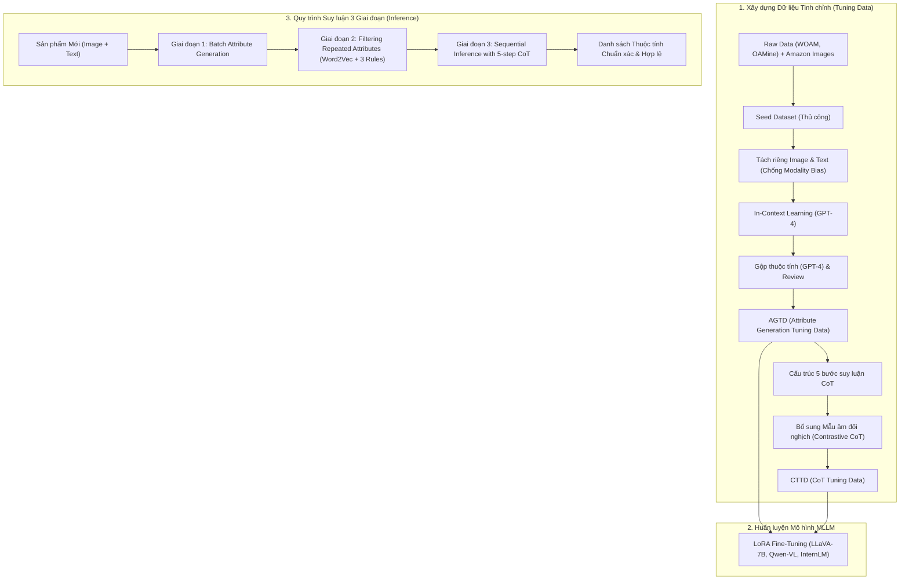

# Đánh giá & Phân tích Chuyên sâu Bài báo ACL 2025 (Long Paper)

> **Tên bài báo:** Open-World Attribute Mining for E-Commerce Products with Multimodal Self-Correction Instruction Tuning  
> **Tác giả:** Jiaqi Li, Yanming Li, Xiao li Shen, Chuanyi Zhang, Guilin Qi, Sheng Bi (Đại học Đông Nam - Southeast University & Đại học Hà Hải - Hohai University, Trung Quốc)  
> **Hội nghị:** The 63rd Annual Meeting of the Association for Computational Linguistics (ACL 2025) – Long Papers (trang 1702–1714)  
> **Mã nguồn/Dữ liệu:** Tác giả cam kết phát hành mã nguồn và bộ dữ liệu.

---

## 1. Bối cảnh & Đặt vấn đề (Background & Motivation)

### 1.1 Khái niệm Open-World Product Attribute Mining (AM)

Trong thương mại điện tử (E-commerce), các **thuộc tính sản phẩm (Product Attributes)** đóng vai trò cốt lõi trong việc:

- Chuẩn hóa danh mục sản phẩm (Catalog enrichment).
- Hỗ trợ công cụ tìm kiếm, lọc và đề xuất sản phẩm (Search, Filtering, Recommendation).
- Giúp người tiêu dùng đưa ra quyết định mua sắm nhanh chóng, chính xác.

Khác với bài toán khai phá thuộc tính truyền thống dạng **Closed-World** (nơi danh sách thuộc tính bị giới hạn trong ontology/schema định trước), bài toán **Open-World Attribute Mining** yêu cầu mô hình phải:

- Khai phá được các thuộc tính **mới**, chưa từng xuất hiện trong schema (Unseen / Free-form attributes).
- Trích xuất đồng thời cả **Tên thuộc tính (Attribute Name)** và **Giá trị thuộc tính (Attribute Value)** từ thông tin giới thiệu sản phẩm.

### 1.2 Hai hạn chế cốt lõi của các nghiên cứu trước đây

Mặc dù đã có nhiều mô hình tiền nhiệm (như OpenTag, OA-Mine, Amacer), các tác giả chỉ ra hai lỗ hổng lớn:

1. **Chưa tận dụng thông tin Đa phương thức (Underutilization of multimodal information):**
   - Hầu hết các phương pháp chỉ tập trung vào văn bản (tiêu đề, bullet points, mô tả sản phẩm).
   - Tuy nhiên, hình ảnh sản phẩm (bao bì, hình dáng đóng gói, thông số in trên vỏ hộp) chứa đựng vô số thuộc tính giá trị mà văn bản không hề đề cập (ví dụ: `Product_shape: Powder`, `Weight: 1lb`, `Packaging Type: Pouch`).
2. **Thiếu vắng quy trình suy luận tường minh (Absence of explicit reasoning):**
   - Các mô hình phân loại (classification-based) hoặc mô hình sinh ngôn ngữ trước đây thường sinh kết quả một cách trực tiếp mà không giải thích hay suy luận logic.
   - Hậu quả: Mô hình dễ sinh ra các thuộc tính "rác", không phù hợp ngữ cảnh hoặc nhầm lẫn slogan tiếp thị thành thuộc tính (ví dụ coi `"Calm and clarity"` hay `"Marketing Claims"` là thuộc tính sản phẩm).
   - Nếu áp dụng suy luận CoT (Chain-of-Thought) tự do/thông thường (Vanilla CoT), mô hình ngôn ngữ lớn (LLM) lại dễ sinh ra các lý lẽ ảo giác (**hallucinated rationales**), làm giảm sút chất lượng trích xuất.

---

## 2. Phương pháp đề xuất: Framework MSIT

Để giải quyết hai bài toán trên, nhóm tác giả đề xuất khung làm việc **MSIT (Multimodal Self-Correction Instruction Tuning)** sử dụng các mô hình ngôn ngữ đa phương thức lớn (**MLLMs - Multimodal Large Language Models**).

Kiến trúc MSIT bao gồm 3 trụ cột chính:

1. **Attribute Generation Tuning Data (AGTD) Construction** – Xây dựng dữ liệu tinh chỉnh sinh thuộc tính.
2. **Chain-of-Thought Tuning Data (CTTD) Construction** – Xây dựng dữ liệu tinh chỉnh chuỗi suy luận tự sửa lỗi 5 bước.
3. **3-Stage Attribute Inference** – Quy trình suy luận 3 giai đoạn (Sinh hàng loạt $\rightarrow$ Lọc trùng lặp $\rightarrow$ Thẩm định tuần tự bằng CoT 5 bước).

---

### 2.1 Thành phần 1: Xây dựng AGTD (Attribute Generation Tuning Data)

- **Mở rộng dữ liệu:** Tác giả lấy hai tập dữ liệu đơn phương thức chuẩn nổi tiếng là **WOAM** (gồm Tea, Vitamin, Sofa, Phone Case) và **OAMine** (100 product types), sau đó thu thập hình ảnh sản phẩm tương ứng từ **Amazon.com** để biến thành dữ liệu đa phương thức.
- **Seed Dataset:** Xây dựng tập thuộc tính mẫu ban đầu được kiểm duyệt kỹ càng cho từng loại sản phẩm.
- **Giải quyết Modality Attention Bias:**
  - _Quan sát thực nghiệm:_ Khi đưa cả ảnh và văn bản vào GPT-4 cùng lúc, mô hình bị thiên kiến chú ý mạnh vào văn bản và gần như bỏ qua hình ảnh.
  - _Giải pháp:_ Đưa ảnh riêng để sinh `Image Attributes`, đưa văn bản riêng để sinh `Text Attributes`. Sau đó dùng GPT-4 gộp (merge) lại và con người kiểm duyệt lọc bỏ thuộc tính sai.
- **Định dạng đầu ra:** Toàn bộ dữ liệu được cấu trúc dưới dạng cặp **Thuộc tính - Giá trị** (`{Attribute: Value}`) thay vì chỉ lưu tên thuộc tính.

---

### 2.2 Thành phần 2: Xây dựng CTTD (Chain-of-Thought Tuning Data) với 5 bước suy luận

Để triệt tiêu ảo giác và giúp MLLM tự kiểm chứng (self-correction), tác giả thiết kế quy trình lập luận **5 bước chặt chẽ**:

| Bước       | Tên bước                                           | Chức năng cụ thể                                                                                                                                                                                        |
| :--------- | :------------------------------------------------- | :------------------------------------------------------------------------------------------------------------------------------------------------------------------------------------------------------ |
| **Step 1** | **Product Type Range Narrowing**                   | Phân tích cả ảnh và văn bản để xác định chính xác danh mục/loại sản phẩm (vd: ốp điện thoại, trà thảo mộc, sofa...), từ đó khoanh vùng phạm vi các thuộc tính hợp lệ.                                   |
| **Step 2** | **Reasoning with Internal Common-sense Knowledge** | Áp dụng tri thức thường thức (Common-sense) để đánh giá sơ bộ xem thuộc tính đang xét có ý nghĩa và có thể áp dụng cho loại sản phẩm này không (vd: Vitamin thì không thể có thuộc tính `screen_size`). |
| **Step 3** | **Image-Based Attribute Validation**               | Dùng hình ảnh để xác minh xem sản phẩm có thuộc tính này hay không (chỉ cần xác nhận giá trị thô/ước lượng từ hình ảnh).                                                                                |
| **Step 4** | **Text-Based Attribute Verification**              | Dùng văn bản để xác nhận xem có bằng chứng rõ ràng cho thuộc tính không; nếu có thì trích xuất giá trị chính xác.                                                                                       |
| **Step 5** | **Final Evaluation and Decision-Making**           | Tổng hợp toàn bộ suy luận ở 4 bước trước để đưa ra phán quyết nhị phân cuối cùng: **Yes** (hợp lệ) hoặc **No** (bác bỏ).                                                                                |

#### Contrastive Chain-of-Thought Tuning Data (Mẫu âm đối nghịch)

Nếu chỉ huấn luyện với các thuộc tính hợp lệ (nhãn luôn là "Yes"), mô hình sẽ học vẹt và luôn trả lời "Yes". Nhóm tác giả đã bổ sung các **mẫu âm (Negative Samples)** – lấy thuộc tính từ các danh mục sản phẩm hoàn toàn khác (được chọn lọc thủ công) để đảm bảo tỷ lệ mẫu Dương/Âm cân bằng (50/50).

---

### 2.3 Thành phần 3: Quy trình Suy luận 3 giai đoạn (3-Stage Inference)

Khi triển khai trên dữ liệu thực tế, MSIT không chạy CoT một cách tùy tiện mà qua 3 giai đoạn:

1. **Stage 1 - Batch Attribute Generation:** MLLM đã fine-tune tiếp nhận hình ảnh + tiêu đề + bullet points, sinh ra một mảng các cặp `{Attribute: Value}` tiềm năng.
2. **Stage 2 - Filtering Repeated Attributes:** Lọc bỏ các thuộc tính đồng nghĩa/trùng lặp (vd: `type` vs `product type`):
   - Sử dụng vector nhúng **`word2vec-google-news-300`** tính cosine similarity giữa các subword.
   - Áp dụng hệ thống **3 Quy tắc heuristic (Rule-based)** dựa trên độ dài subword:
     - _Rule 1:_ Nếu một thuộc tính có 1 subword (A) và thuộc tính kia (B) có 3 subword, xóa A. Nếu B có $>3$ subword, xóa B.
     - _Rule 2:_ Nếu một thuộc tính có 2 subword và thuộc tính kia có $\ge 3$ subword, xóa thuộc tính dài hơn (B).
     - _Rule 3:_ Nếu cả hai có cùng số subword, xóa ngẫu nhiên 1 trong 2.
   - _Tác dụng:_ Giảm đáng kể chi phí tính toán cho giai đoạn tiếp theo và tăng độ tinh gọn.
3. **Stage 3 - Sequential Attribute Inference with 5-step CoT:** Đưa lần lượt từng thuộc tính còn lại qua quy trình CoT 5 bước của MLLM. Chỉ những thuộc tính có phán quyết cuối cùng ở Bước 5 là **"Yes"** mới được giữ lại.

---

## 3. Thiết lập Thực nghiệm (Experimental Setup)

- **Bộ dữ liệu thử nghiệm:**
  - **WOAM:** 4 danh mục phổ biến (Tea, Vitamin, Sofa, Phone Case), >9.000 mô tả tiếng Anh/danh mục.
  - **OAMine:** 100 loại sản phẩm; tập test gồm 1.943 sản phẩm được gán nhãn thủ công qua 10 danh mục.
  - Tỉ lệ phân chia: 1.000 mẫu AGTD + 300 mẫu CTTD để train; 1.000 mẫu để test.
- **Mô hình nền (Backbones) & Fine-tuning:**
  - Áp dụng kỹ thuật **LoRA** trên 3 mô hình MLLM mã nguồn mở hàng đầu: **LLaVA-7B**, **Qwen-VL-chat-7B**, **InternLM-XComposer2-7B**.
  - Phần cứng: 1 GPU NVIDIA Tesla A100; Optimizer Adam, learning rate $3 \times 10^{-4}$, 10 epochs.
  - Decoding khi inference: top_p sampling (temperature = 0.2, top_p = 0.7). Báo cáo giá trị trung bình qua 5 lần chạy độc lập.
- **Thang đo đánh giá (Metrics):**
  - **Precision & Recall** theo 2 tiêu chuẩn:
    - **Exact Match (EM):** Khớp chính xác 100% từng ký tự với nhãn chuẩn vàng.
    - **Similar Match (SM):** Chấp nhận các từ đồng nghĩa (synonyms).
- **Các phương pháp so sánh (Baselines):**
  - MLLMs: VisualGLM-6B, InstructBLIP-vicuna-7B, Qwen-VL-chat-7B, DeepSeek-VL-7B, InternLM-XComposer2-7B, LLaVA-7B, LLaVA-13B, GPT-4 (Multimodal).
  - Mô hình Open-World AM chuyên biệt: OA-Mine (WWW 2022), Amacer (ACL 2023).

---

## 4. Kết quả Thực nghiệm & Phân tích Chi tiết

### 4.1 Kết quả chính (Main Results)

Dưới đây là bảng tóm tắt kết quả chính trên 2 tập dữ liệu (đơn vị: %):

| Mô hình             | WOAM Similar Match (P / R) | WOAM Exact Match (P / R) | OAMine Similar Match (P / R) | OAMine Exact Match (P / R) |
| :------------------ | :------------------------: | :----------------------: | :--------------------------: | :------------------------: |
| **LLAVA-7B** (Gốc)  |       40.49 / 56.21        |      10.61 / 26.22       |        47.07 / 54.99         |       16.71 / 26.82        |
| **LLAVA-13B**       |       41.22 / 64.62        |      10.52 / 37.72       |        51.87 / 58.59         |       21.46 / 37.75        |
| **GPT-4**           |       52.03 / 65.35        |      15.51 / 41.60       |        64.92 / 55.75         |       29.25 / 33.72        |
| **OA-Mine**         |       42.27 / 53.62        |      17.52 / 26.72       |        53.85 / 47.71         |       18.15 / 35.69        |
| **Amacer**          |       51.27 / 58.30        |      21.91 / 29.23       |        58.41 / 51.65         |       22.98 / 38.84        |
| **MSIT (Qwen)**     |       59.95 / 41.60        |      20.00 / 23.75       |        65.01 / 52.44         |       24.61 / 38.13        |
| **MSIT (InternLM)** |       63.40 / 46.80        |      25.00 / 25.53       |        70.79 / 46.99         |       37.52 / 27.37        |
| **MSIT (LLAVA-7B)** |     **66.90 / 66.99**      |    **35.34 / 52.50**     |      **74.50 / 63.06**       |     **54.33 / 51.54**      |

#### Những điểm nổi bật

1. **Vượt trội toàn diện:** MSIT (LLaVA-7B) đánh bại tất cả các baselines hiện đại nhất, kể cả GPT-4 và các mô hình AM chuyên biệt (Amacer, OA-Mine).
2. **Cải thiện vượt bậc so với Backbone gốc:** Trên WOAM, MSIT nâng độ chính xác Exact Match của LLaVA-7B từ **10.61% lên 35.34%** (tăng hơn 3.3 lần); Recall từ **26.22% lên 52.50%** (tăng gấp đôi).
3. **Độ chính xác vượt trội trên OAMine:** Đạt **54.33% Exact Match Precision**, cao hơn gấp đôi so với Amacer (22.98%) và vượt xa GPT-4 (29.25%).

---

### 4.2 Phân tích Đóng góp Thành phần (Ablation Study)

- **Ảnh hưởng của Dữ liệu Huấn luyện (AGTD & CTTD):**
  - Chỉ dùng AGTD: Cải thiện mức vừa phải (WOAM Similar Match: P 62.15%, R 62.52%).
  - Chỉ dùng CTTD: Kết quả thấp hơn (P 50.15%, R 45.88%) vì thiếu khả năng sinh thuộc tính đa dạng ban đầu.
  - Kết hợp cả AGTD + CTTD: Đạt hiệu năng tối ưu (P 63.89%, R 67.42%), chứng minh hai nguồn dữ liệu này bổ trợ tương hỗ chặt chẽ.
- **Ảnh hưởng của Quy trình Suy luận 3 giai đoạn (S1, S2, S3):**
  - Stage 1 (Batch Generation): Đặt nền tảng ứng viên.
  - Stage 2 (Lọc trùng lặp): Vừa giảm tải tính toán cho Stage 3, vừa loại bỏ nhiễu đồng nghĩa, giữ ổn định Precision và Recall.
  - Stage 3 (5-step CoT Verification): Là nhân tố tạo bước nhảy vọt cuối cùng, đưa Similar Match Precision lên **66.90%** và Recall lên **66.99%**.
- **Định dạng Đầu ra (Output Format):**
  - Khi chỉ sinh Tên thuộc tính (`Attri-only`), điểm Exact Match Precision giảm **28.68%** và Recall giảm **38.37%**. Việc yêu cầu mô hình sinh luôn cả cặp `{Attribute: Value}` giúp neo ngữ nghĩa (grounding) chính xác hơn nhiều.
- **Quy mô Dữ liệu CTTD:**
  - Đáng chú ý, chỉ cần tăng CTTD từ 100 lên 300 mẫu, Recall của Similar Match tăng mạnh từ **53.88% lên 66.99%**, cho thấy suy luận CoT có cấu trúc giúp mô hình "khai mở" khả năng nhận diện các thuộc tính tiềm năng rất nhanh chóng với lượng dữ liệu nhỏ.

---

### 4.3 Phân tích Đa phương thức & Cơ chế Tự sửa lỗi (Self-Correction)

1. **Hiệu quả của Hình ảnh (Visual Modality):**
   - Khi so sánh với GPT-4 trên từng kênh đầu vào riêng lẻ (Image, Bullet points, Title):
     - Trên kênh Hình ảnh: MSIT đạt Exact Match Precision **40.96%**, bỏ xa GPT-4 (**23.81%**).
     - Kênh hình ảnh đóng góp lượng lớn thuộc tính thực tế mà văn bản không nhắc đến (chứng minh tính thiết yếu của đa phương thức).
2. **Độ chính xác của Cơ chế Tự sửa lỗi (Self-Correction):**
   - Đánh giá trên 1.028 thuộc tính được đưa vào Stage 3:
     - 93.3% được phán quyết là Dương tính (Positive).
     - 6.7% bị phán quyết là Âm tính (Negative).
     - Trong số các phán quyết âm tính đó, **98.6% là các phán đoán sửa sai chính xác (Self-corrected Negatives)**, chỉ có **1.4% là bị đánh giá nhầm**.
     - Điều này chứng minh CoT 5 bước hoạt động như một "bộ lọc bảo vệ" cực kỳ chuẩn xác, loại trừ thuộc tính ảo giác mà hầu như không làm tổn hại đến Recall.
3. **Khả năng thích ứng miền (Domain Adaptation):**
   - Thử nghiệm Cross-Validation (Huấn luyện trên 3 danh mục, kiểm thử trên danh mục thứ 4 hoàn toàn xa lạ): MSIT duy trì vị trí số 1 trên tất cả các danh mục (Sofa, Phone, Tea, Vitamin), chứng minh khả năng tổng quát hóa thực sự trong môi trường Open-World.

---

## 5. Đánh giá Tổng thể & Ý nghĩa Ứng dụng

### 5.1 Ưu điểm nổi bật (Strengths)

1. **Thiết kế giải quyết trúng hai "tử huyệt":** Khắc phục triệt để hiện tượng bỏ quên hình ảnh (qua cơ chế tách đầu vào khi tạo AGTD) và ảo giác gán slogan làm thuộc tính (qua CoT 5 bước và mẫu âm đối nghịch).
2. **Quy trình suy luận thực tế (Practical 3-Stage Pipeline):** Kết hợp hài hòa giữa sinh hàng loạt tốc độ cao (Batch), bộ lọc heuristic tối ưu tài nguyên (Stage 2) và kiểm chứng suy luận sâu (Stage 3).
3. **Hiệu quả mẫu cực cao (Sample Efficiency):** Chỉ cần 1.000 mẫu AGTD và 300 mẫu CTTD cùng kỹ thuật LoRA trên một GPU A100 duy nhất đã vượt qua mô hình khổng lồ như GPT-4.

### 5.2 Hạn chế & Góc nhìn phản biện (Limitations)

1. **Quy mô tham số mô hình:** Nhóm tác giả mới chỉ thử nghiệm trên các MLLM 7B (LLaVA-7B, Qwen-VL-7B, InternLM-7B) do giới hạn tài nguyên tính toán; chưa đánh giá trên các mô hình 13B, 34B hay 70B.
2. **Độ trễ suy luận (Inference Latency):** Việc chạy suy luận CoT 5 bước tuần tự (Sequential) cho từng thuộc tính ở Stage 3 có thể làm tăng thời gian xử lý nếu một sản phẩm có quá nhiều thuộc tính ứng viên, cần tối ưu hóa batching hoặc kỹ thuật suy luận song song.
3. **Phương thức mở rộng:** Hiện tại chỉ kết hợp Ảnh 2D + Văn bản; chưa mở rộng sang video trình diễn sản phẩm hay bảng dữ liệu cấu trúc phức tạp.

---

## 6. Kết luận

Bài báo **MSIT (ACL 2025 Long Paper)** là một đóng góp xuất sắc và mang tính tiên phong trong việc đưa mô hình ngôn ngữ đa phương thức (MLLM) vào bài toán **Open-World Attribute Mining** trong thương mại điện tử. Với thiết kế tinh chỉnh chỉ dẫn tự sửa lỗi kết hợp dữ liệu đối nghịch và quy trình suy luận 3 giai đoạn, MSIT đã thiết lập một tiêu chuẩn mới (SOTA) về cả độ chính xác (Precision) lẫn độ bao phủ (Recall), mở ra tiềm năng ứng dụng rất lớn cho việc tự động hóa làm giàu dữ liệu sản phẩm trong thực tế.
